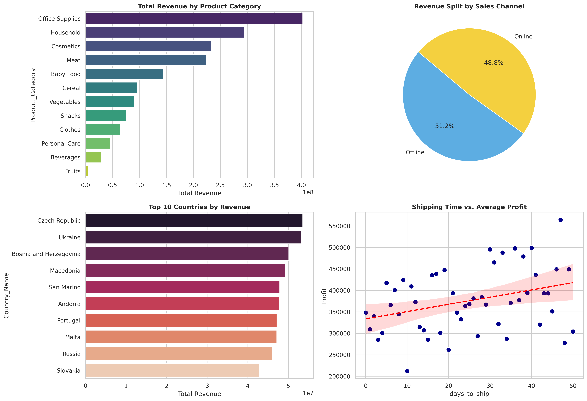

# 🐍 Global Market Company — End-to-End Sales & Logistics Data Analysis (Python)

## 📌 Project Overview
This project performs a comprehensive commercial, financial, and logistics analysis of **Global Market Company** using **Python (Pandas, Matplotlib, Seaborn)**. By integrating transactional sales data (`events.csv`) with product (`products.csv`) and geographic (`countries.csv`) catalogs, this notebook uncovers actionable insights regarding revenue drivers, profit margins, omnichannel balance, supply chain efficiency, and seasonal demand.

## 💰 Executive Financial Summary
* **Total Orders:** 1,328
* **Covered Countries:** 45
* **Total Revenue:** $1,702,129,408.21
* **Total Cost:** $1,200,694,949.21
* **Total Net Profit:** $501,434,459.00
* **Global Profit Margin:** 29.46%

## 🔍 Key Business & Analytical Insights
* **Data Quality & Standardization:** Audited null values (removing 0.15% incomplete rows in `Units Sold`), mapped unrecorded country codes as `"Unknown"`, and normalized text casing/whitespace anomalies in `Sales Channel` and `Order Priority`.
* **Omnichannel Balance:** Online and Offline sales channels maintain a nearly **50/50 revenue split**, confirming a healthy omnichannel strategy.
* **Supply Chain & Profitability Resilience:** Regression analysis between shipping duration (`days_to_ship`) and net `Profit` reveals a flat trend, proving that longer delivery windows do not erode net profit margins per order.
* **Weekly Seasonality & Restocking:** Breakdown of unit volume by `Day_of_Week` uncovers distinct category-level demand spikes, supporting data-driven inventory restocking and targeted ad scheduling.

## 🛠️ Tech Stack & Libraries
* **Python 3:** `Pandas` (relational merges, feature engineering, aggregations), `NumPy`, `Matplotlib`, and `Seaborn` (bar charts, pie charts, regression plots, and multi-series line charts).

## 📂 Repository Contents
* `Global_Market_Sales_Analysis.ipynb` — Complete Jupyter/Colab notebook with code, outputs, and executive conclusions.
* `python_analysis_preview.png` — Visual summary of commercial revenue and channel distribution.
